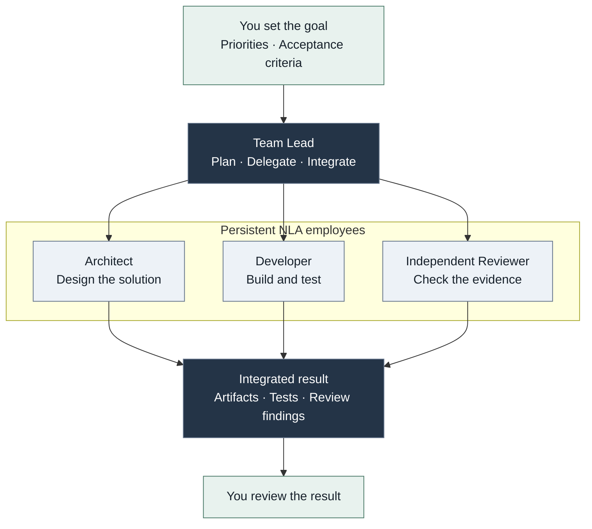
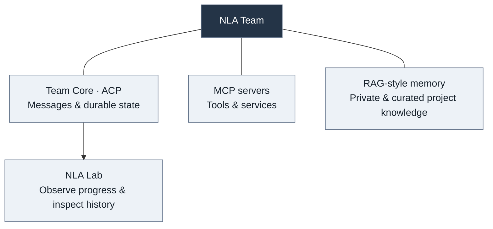
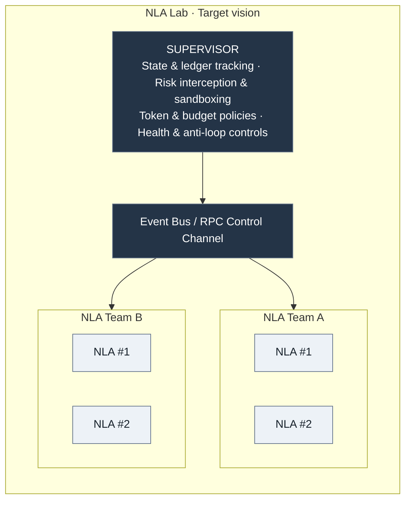
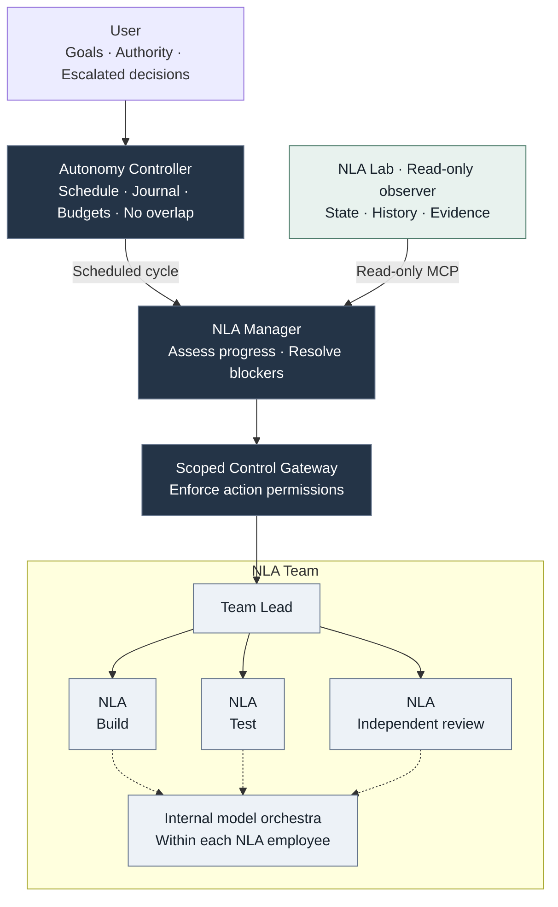
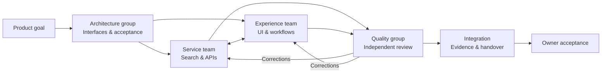

<h1 align="center">
  
   
  NLA Team
</h1>

<strong>Your next engineering team is a team of agents.</strong> Agile Teams · MCP · RAG · Multi-model Orchestration

> **Give the team a goal. Follow the work. Review the result.**

**Status: experimental · private testing · source code is not open source at this time.**

This repository contains an architecture preview, not the implementation or an installable release.

## One goal. A coordinated team.

Persistent AI employees built on [Next Level Agent](https://github.com/pickleshell/next-level-agent).

The Lead coordinates corrections and integration; independent review supplies evidence for acceptance.

**Shared infrastructure — available throughout the workflow:**

**MCP connects tools. ACP connects teammates.** Native tools and APIs remain supported.

| Concept | Purpose |
| --- | --- |
| **Agile Teams** | Clear ownership · Parallel work · Feedback |
| **Scrum / Kanban** | Backlog · Ready/Done criteria · Review |
| **Model Orchestras** | Specialist roles and model selection within each employee |
| **RAG-style memory** | Retrieve reviewed knowledge · Preserve provenance |
| **Persistent state** | Checkpoints · Session recovery · Continuity |
| **Independent review** | Exact artifacts · Reproducible checks · Honest results |

## Agent → Team → Lab

**One employee is already an agent system.** Each NLA instance can orchestrate specialist roles, delegate work and review results. NLA Team coordinates these persistent employees; the Lab ecosystem adds observation and a developing cross-team management loop.

| Layer | Responsibility |
| --- | --- |
| **Next Level Agent** | Individual execution · Internal model orchestra · Context continuity |
| **NLA Team** | Team Lead · Persistent employees · ACP coordination · Independent review |
| **NLA Lab ecosystem** | Cross-team visibility · Evidence · Proposed autonomous process management |

### Conceptual organization

The following diagram expresses the **target vision**, not a list of shipped capabilities. “Supervisor” names the supervisory layer; its reasoning and enforcement responsibilities are separated in the operational design below.

### Operational boundaries

**Lab observes. Manager reasons. Controller and Gateway enforce. Leads coordinate delivery.**

The management loop is being implemented and validated. The existing **Lab MCP remains read-only**; coordination actions use a separate scoped gateway. Team Core remains authoritative for team records.

- **Evidence before intervention:** freshness, provenance and incomplete observations remain visible.
- **Lead-owned execution:** Manager coordinates enrolled teams through their Leads.
- **Bounded autonomy:** scoped actions, durable obligations and explicit escalation.
- **No blind replacement:** an invocation with an unknown outcome blocks replacement until reconciliation.

A journal is **not** automatic rollback of files or external effects. Dynamic team resizing, universal risk interception and guaranteed anti-loop recovery are not claimed as implemented. Reliable cancellation/quiescence and confirmed external operator notification remain release gates for unattended operation.

The objective is measurable: **less operator prompting, verified recovery from stalled work, and completed tasks backed by evidence.** Architectural scope alone is not proof of superiority over another framework.

## Several groups. One outcome.

Illustrative workflow: **build an internal knowledge portal**.

Organizational patterns, not a claim of automatic Scrum ceremonies or a cross-team dispatcher.

## Testing: progress and limits

**Observed in private testing:** durable messaging, shared-memory promotion, versioned handoffs, independent review, and session recovery.

**43 employees · 13 teams** updated and restarted in one maintenance run, with prior sessions restored and infrastructure checks passing. This is operational evidence, not a productivity benchmark.

**Still improving:** stalled handoffs · interface drift · model reliability · context recovery · coordination cost.

Human oversight remains necessary. Healthy processes do not prove completed work. Current deployments assume trusted environments.

## Interested?

**Private testers · Architecture reviewers · Integration partners**

Have a workflow worth testing? Want to collaborate or ask a question? [Open an issue](https://github.com/pickleshell/nla-team/issues) if you have repository access, or visit the [maintainer’s GitHub profile](https://github.com/pickleshell).

**Email:** [pickleshell.plugin@gmail.com](mailto:pickleshell.plugin@gmail.com)

Testing access is arranged individually. **Implementation source remains private; no public release date is promised.**

---

Built around [Next Level Agent](https://github.com/pickleshell/next-level-agent). See that project for its release status, acknowledgements and licensing. This preview does not publish the private NLA Team implementation.
