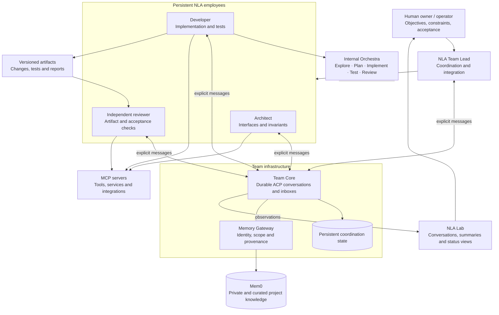
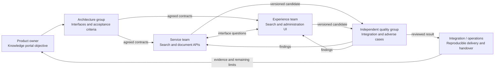

<h1 align="center">
  
   
  NLA Team
</h1>

<strong>Your next engineering team is a team of agents.</strong> Agile teams · MCP tools · RAG memory · Independent review

**Give the team a goal. Follow the work. Review the result.**

NLA Team brings the structure of an engineering organization to AI agents: a Team Lead, specialist employees, shared knowledge, and independent review. Built on [Next Level Agent](https://github.com/pickleshell/next-level-agent), it connects persistent agents to tools and services through MCP integrations, with durable communication between teammates.

**One objective → clear ownership → parallel execution → reviewed delivery.**

> **Architecture preview · Private testing** — This repository presents the concept and architecture. Implementation source and installation packages are not published here.

## The concept at a glance

| Building block | What it brings |
| --- | --- |
| **Agile AI Teams** | Persistent specialists with responsibilities, a shared objective, and a Team Lead |
| **MCP integrations** | A common tool interface for connecting agents to supported services and capabilities |
| **Scrum / Kanban workflows** | Backlog, work packages, Definition of Ready/Done, review and feedback—adapted to the project |
| **RAG-style project memory** | Retrieve relevant, reviewed knowledge instead of rebuilding context from scratch |
| **Model Orchestras** | Select models and specialist roles for each employee's internal work |
| **NLA Lab** | Inspect conversations, summaries, handoffs and operational status |
| **Independent review** | Check the actual delivery, with evidence and reproducible results |

## Architecture: teams above models, tools behind interfaces

An **NLA employee** is a persistent agent, not just a model call. It has its own context, tools, working state and internal Orchestra. A **Team** coordinates several employees around a project.

- **Team Lead** decomposes the objective, assigns ownership, resolves dependencies and integrates results.
- **Employees** own assignments end to end. Their internal Orchestra can explore, plan, implement, test and review.
- **Independent reviewers** check the delivered revision; an employee's self-review is not final acceptance.
- **Team Core** persists messages, inboxes and coordination state. It is infrastructure, not another model or a central workflow brain.
- **MCP servers** expose connected tools. **ACP** carries explicit messages between employees through Core. Native tools and APIs remain part of the implementation; MCP is not the transport for every internal operation.
- **The human owner** sets direction, acceptance intent and deployment authority.

The diagram shows a representative team. Roles and team size follow the work.

## Agile teams, without unnecessary ceremony

Organize work as a sprint, a Kanban flow, or a simple delivery cycle:

**Backlog → clarify → assign → implement → review → integrate → feedback.**

The Team Lead coordinates dependencies. Employees ask each other questions and report blockers. A useful handoff includes the exact artifact, verification results, remaining limitations and the next owner.

Scrum and Kanban describe operating practices—not a claim that Core implements every ceremony, board or automatic transition. The goal is useful delivery, not more meetings between models.

## Example: several groups, one outcome

**“Build a searchable internal knowledge portal with controlled access.”**

An architecture group defines the interfaces. Service and experience teams work in parallel. Independent quality review tests their integrated candidate. Operations prepares the handover.

This is an illustrative organization pattern, not a completed deployment or an automatic cross-team dispatcher. Each group keeps explicit ownership; agreed contracts make parallel work possible.

The same pattern supports research, architecture, implementation, testing and operations. Begin with a small team; add a group when the work is genuinely separable.

## MCP: connect the team to its tools

The architectural direction is straightforward: **give agents well-defined capabilities through MCP servers** instead of embedding every external integration into the coordinator.

An MCP integration can expose an external service or a bounded operation; NLA employees decide when to use the tools available to their role. Team management also has MCP-facing views alongside CLI and dashboard access.

Tool availability is explicit. Connecting a server does not prove its operations work, and not every employee needs every tool. Integration checks should exercise the actual endpoint and distinguish a successful call from a completed task.

## RAG memory: knowledge that survives the conversation

Project memory follows a retrieval-augmented pattern: agents search for relevant facts and bring them into the current task. Mem0 provides semantic memory behind Core's Memory Gateway.

**Private knowledge → proposed shared fact → Lead review → project memory.**

Shared knowledge carries provenance. Messages do not automatically become accepted facts, and separate teams do not silently share every memory. An unavailable memory service does not stop team communication.

Memory, conversation summaries and execution checkpoints serve different purposes. On recovery, an employee reconciles them with current artifacts. Remembering a claim is not the same as verifying it.

## What testing shows

The working implementation is being tested privately on engineering workloads. Maintainer-observed results include:

- Durable conversations, employee inboxes and direct coordination between agents.
- Versioned implementation handoffs, integration candidates and independent review findings.
- Private/project memory scopes with explicit promotion and provenance.
- Lab observation with summaries and original messages available for inspection.
- A maintenance run across **43 employees in 13 teams**, with prior sessions restored and infrastructure checks passing.
- Reproduction and repair of a missing-checkpoint recovery failure, backed by regression tests.

These are practical development results, not an independent benchmark. The employee count does not establish concurrent useful work, productivity gains or a recommended team size.

## Why it matters—and what still needs work

**Continuity. Parallelism. Accountability.** Persistent employees retain working context; clear interfaces let teams divide work; independent review makes results inspectable.

The system is still experimental:

| Current challenge | What we are improving |
| --- | --- |
| A delivered message may not start the next employee | Handoff visibility and recovery |
| Parallel workers may diverge on interfaces | Ownership, contract agreement and integration checks |
| Model summaries can overstate success | Evidence-based status and independent acceptance |
| Context or provider failures can interrupt work | Checkpointing, restoration and bounded fallback |
| More agents can increase cost and coordination overhead | Small effective teams and measurement of useful outcomes |

Operator intervention is still needed in some cases. Current trusted-deployment assumptions are not a claim of hardened multi-tenant isolation. Neither healthy containers nor fluent reports prove autonomous completion.

## Join the testing conversation

**Building with agents? Help shape how they work together.**

We welcome private testers, architecture reviewers and integration collaborators. Bring a concrete workflow, a difficult handoff, or a recovery scenario worth testing.

If you have repository access, [open an issue](https://github.com/pickleshell/nla-team/issues) to discuss testing, collaboration or other questions. Describe your use case and environment; leave credentials and confidential material out. Access is arranged individually.

---

**NLA Team** is the team-coordination layer around [Next Level Agent](https://github.com/pickleshell/next-level-agent). The individual-agent repository documents its own release status, upstream acknowledgements and licensing. This separate architecture preview contains no implementation sources, deployment scripts or model weights. No source-release date is promised.

*Architecture preview · October 2026*
