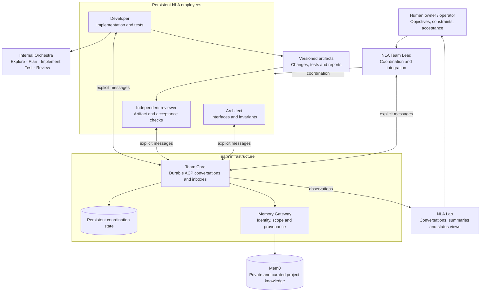
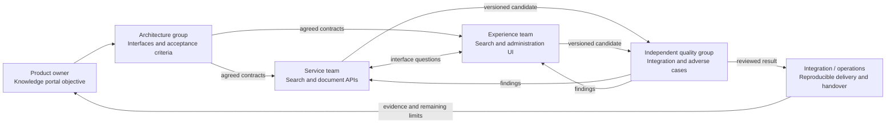

<h1 align="center">
  
   
  NLA Team
</h1>

**Persistent teams of AI agents that coordinate work, preserve knowledge, and deliver results for independent review.**

NLA Team extends [Next Level Agent (NLA)](https://github.com/pickleshell/next-level-agent) from an individual engineering agent into a team of persistent collaborators. A Team Lead coordinates the objective, specialized employees own bounded assignments, and an independent reviewer checks the integrated result.

The aim is to make longer engineering work manageable across multiple agents and sessions: clear ownership, explicit communication, recoverable state, and evidence that can be inspected by a human.

> **Experimental · Architecture preview**
>
> This repository describes the architecture, operating principles, and development experience. It does not contain the private implementation, model credentials, deployment configuration, or an installable release. The working implementation is being tested privately. Publication of this overview is not a commitment to a source-release date.

## From one agent to a team

An NLA employee is an agent instance with its own working context, persistent state, tools, and model configuration. It can perform an assignment through its own internal **Orchestra**: specialist roles such as Explorer, Architect, Implementer, Test Writer, Reviewer, and Supervisor.

NLA Team adds coordination between these employees. An internal role invocation is not an additional persistent employee, and an employee's internal review does not replace independent review of the team's delivery.

| Level | Responsibility |
| --- | --- |
| Human owner / operator | Defines objectives, priorities, constraints, and acceptance intent; controls deployment and access |
| Team Lead | Decomposes work, assigns ownership, negotiates interfaces, coordinates dependencies, integrates results, and escalates blockers |
| NLA employee | Owns a bounded engineering assignment and its evidence; communicates with colleagues |
| Employee Orchestra | Routes internal work to suitable specialist roles and models |
| Independent reviewer | Examines the exact delivered artifact and checks claims independently |
| Team Core | Provides durable communication and scoped memory access; does not make engineering decisions |

## Architecture

The arrows show responsibilities and information flow, not a centrally enforced sequence of model calls. Team composition varies by project; the diagram is a representative arrangement.

### Team Core is infrastructure

Each team has a separate Core and persistent coordination state. Core carries the **Agent Communication Protocol (ACP)**: explicit conversations, messages, and employee inboxes. Employees may communicate directly with one another through this channel.

Core is not the Team Lead, an LLM, or a universal workflow engine. It does not interpret every message into a mandatory next action. Employee provisioning and credentials are managed separately by the operator; Core does not require Docker control.

A persisted message and an actively executing employee are different states. An idle notification can prompt an employee to inspect its inbox, but the delivery and execution boundary still needs observation and recovery.

### Persistent employees, replaceable processes

Employees retain their working state and conversation history across process or container replacement. Stable identities and persistent storage are essential: recreating a process should not silently create a different employee or project.

Persistence is not perfect recall. Context summaries, structured checkpoints, repository state, and memory have different purposes. Recovery must reconcile them with current artifacts rather than treating an old summary as proof that the work is still complete.

### Memory with explicit scope

Employees have private knowledge; projects have curated shared knowledge. An employee can offer a fact for sharing, and the Team Lead can explicitly promote a reviewed fact into project memory. Provenance records connect shared knowledge to its source and promotion decision.

One memory service can support many teams without merging all their memories. Messages are not automatically converted into authoritative project knowledge. Memory availability is also separate from communication: a memory-service outage should not prevent colleagues from exchanging messages.

The current implementation assumes a trusted deployment. Namespace checks and scoped APIs should not be mistaken for a proven boundary against arbitrary code with network access to an unprotected backing service.

### Observation through NLA Lab

Lab presents team conversations and operational information, with derived summaries for easier reading. Original messages remain available for inspection. Viewing a conversation should not acknowledge it on an employee's behalf.

Infrastructure health, model availability, work in progress, and accepted delivery must be reported separately. A running container is not evidence of useful progress, and a fluent summary is not acceptance evidence.

## Working through groups

Several teams can contribute to a larger objective while keeping separate ownership and working state. A department-level grouping is an organizational pattern; this preview does not claim an implemented automatic cross-team dispatcher.

The following example is illustrative, not a report of a completed deployment.

**Objective:** “Build a searchable internal knowledge portal with controlled access and a clear operations handover.”

1. **Agree on the work.** The owner describes the desired outcome. Architecture clarifies interfaces, dependencies, unanswered questions, and observable acceptance criteria.
2. **Assign ownership.** Each Team Lead turns its part into bounded employee assignments. Parallel work starts where the agreed interfaces make it independent.
3. **Communicate explicitly.** Employees ask questions, report blockers, and negotiate changes through durable messages. Shared memory supplies reviewed background, not hidden instructions.
4. **Hand off artifacts.** A developer supplies the exact revision, changed files, verification commands, results, and known limitations. The recipient must actually have access to that artifact.
5. **Review independently.** Quality checks the delivered revision in a reproducible environment. Missing files, incompatible interfaces, or failed checks return as concrete findings.
6. **Integrate and accept.** Leads coordinate corrections. The owner receives a result with evidence and unresolved limitations. Publication or deployment follows the authority granted for the task.

For example, “the search endpoint is ready” is insufficient. A useful handoff identifies the revision, API contract, passing checks, remaining pagination limitation, and the location of the artifact to review.

## Architectural principles

- **Ownership before parallelism.** Every work package has an owner, an interface, and a reviewable result. Adding agents does not resolve ambiguous responsibility.
- **Explicit communication.** Team decisions travel through identifiable messages. An employee's private context is not implicitly available to everyone else.
- **Evidence before completion claims.** Artifacts and checks take precedence over summaries. Independent review targets the actual candidate, not a developer's description of it.
- **Durability with reconciliation.** Conversations and state persist, but resumed work must account for repository changes and incomplete recovery.
- **Model choice by role.** Employees can use different models for routine work, coordination, architecture, and review. Configured fallback is not proof of a successful live provider call.
- **Project separation.** Teams keep distinct identities, coordination state, and memory scope. Shared infrastructure need not mean shared authority.
- **Human control.** Objectives, credentials, deployment boundaries, and consequential approvals remain explicit. Team Core does not grant itself new authority.
- **Visible limitations.** A blocked task stays distinguishable from a completed one. Unknown evidence must remain unknown.

## What private testing has shown

The implementation is under active private testing on engineering workloads. These are maintainer-observed results, not an independent benchmark or a production reliability guarantee.

| Area | Observed result | Limit of the evidence |
| --- | --- | --- |
| Team communication | Persistent conversations, employee inboxes, direct questions and coordination messages have been exercised | Message delivery alone does not guarantee the recipient starts work |
| Engineering handoffs | Teams have produced versioned changes, integration candidates and independent review findings | A handoff can still omit an artifact or include evidence from an uncommitted worktree |
| Collective memory | Private and project scopes, explicit promotion and provenance have been tested | Memory quality depends on what is stored and reviewed |
| Observation | Conversations and derived summaries are available through Lab | Summaries can lag or overstate progress unless checked against source evidence |
| Employee replacement | A recent maintenance run updated 43 employee instances across 13 teams and restored their prior sessions; infrastructure checks passed | This is an operations result, not proof that 43 agents were simultaneously performing useful work |
| Context recovery | A missing-checkpoint failure was reproduced and patched; regression checks cover recovery and blocked failure cases | Longer live runs and provider-specific recovery behavior still need continued testing |

The employee count describes one test environment. It is not a requirement, recommended team size, or claim of linear productivity gains. This preview does not publish a controlled productivity, cost, or model-quality benchmark.

## Advantages and current limitations

The practical advantages are durable coordination, visible ownership, parallel work across agreed boundaries, independent review, and reusable project knowledge. Separate employees also allow model and tool choices to reflect the assignment rather than forcing every task through one configuration.

These benefits bring costs and failure modes that are part of the ongoing work:

| Limitation | Practical impact | Development focus |
| --- | --- | --- |
| Idle handoff gaps | A sender can finish while the recipient never starts | Observable delivery, recipient readiness and explicit recovery |
| Divergent implementations | Separate workers can produce incompatible interpretations of an interface | Interface agreements, ownership boundaries and integration review |
| Unreliable completion summaries | A model may report success despite failed criteria or partial execution | Runtime evidence and precise result categories |
| Context recovery failures | Missing checkpoints or unsuccessful restoration can interrupt long sessions | Runtime checkpointing, reconciliation and meaningful error reporting |
| Provider and model variability | Tool use, latency, limits and fallback behavior vary | Real role-level tests, bounded retries and explicit fallback evidence |
| Coordination overhead | More employees can increase messages, cost and integration effort | Smaller effective teams and measurement of useful outcomes |
| Deployment assumptions | Trusted-network setups are not hardened multi-tenant services | Clear boundaries and deployment-specific controls |

NLA Team is not presented as an unattended organization that reliably completes arbitrary projects. Operator intervention is still needed in some failure and integration cases. The goal is to make those cases visible, reproducible, and progressively easier to recover from.

## Participate in testing

We are interested in conversations with people who would like to:

- participate in private testing with a concrete engineering workflow;
- review the architecture or study multi-agent coordination and recovery;
- compare role orchestration, model reliability, cost, and delivery quality;
- discuss integrations, collaboration, or other questions about NLA Team.

If you have access to this repository, [open an issue](https://github.com/pickleshell/nla-team/issues) with your use case, environment, and what you would like to evaluate. Please leave credentials and confidential project material out of the report. Testing access is arranged individually; this repository does not provide a self-service installation.

## Project relationship and publication scope

NLA Team is developed as the team-coordination layer around **Next Level Agent**. See the [NLA repository](https://github.com/pickleshell/next-level-agent) for the individual-agent project and its own release status, upstream acknowledgements, and licensing information.

This architecture preview is separate from the private implementation repository. Documentation here does not publish that implementation or grant access to it. There are no application sources, deployment scripts, model weights, or credentials in this repository.

*Architecture preview updated October 2026. Capabilities and limitations will be revised as testing produces new evidence.*
